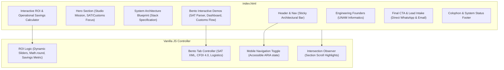
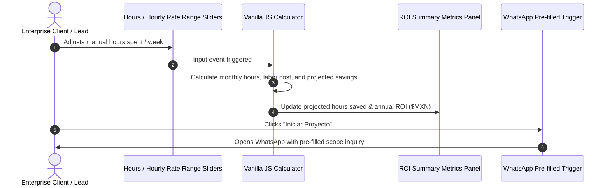

# 🏛️ XAOL Studio Architecture & System Topology

High-performance, editorial landing page for XAOL Studio (`xaol.mx`). Designed following European software house aesthetics: deep architectural matte black (`#09090b`), 1px crisp borders, monochrome technical typography, zero bloated AI design tropes, and sub-100ms load times.

---

## 1. Technology Stack

| Layer | Technology | Details |
| :--- | :--- | :--- |
| **Markup & Semantics** | HTML5 Semantic Living Standard | Full ARIA, accessible dialogs, zero extraneous div soup |
| **CSS Engine** | Tailwind CSS (JIT CDN runtime) | Custom OKLCH / zinc theme, print styles, reduced-motion rules |
| **Typography** | Google Fonts | Inter (sans-serif) & JetBrains Mono (monospace technical blueprint) |
| **Icons** | Lucide Icons (ESM / CDN) | 16px monochrome vector line icons |
| **Interactivity** | Vanilla JavaScript (ES2022) | Native ROI calculation engine, accessible tabs, smooth scroll observer |
| **Hosting & CDN** | GitHub Pages / Cloudflare Edge | Zero server maintenance, instant edge delivery |

---

## 2. System Topology & Section Breakdown



---

## 3. Data & Interaction Flow (ROI Engine)



---

## 4. Directory Structure

```
xaol-website/
├── index.html        # Complete production frontend (HTML, Tailwind config, JS engines)
├── ARCHITECTURE.md   # System architecture and topology documentation
└── README.md         # Deployment instructions and project overview
```
